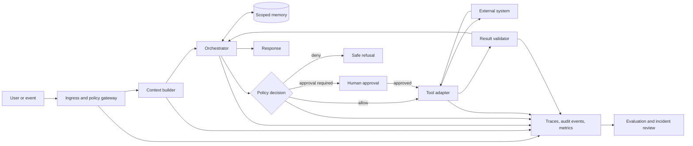

# Agentic System Design Notes

> A field guide for building AI agents that are bounded, observable, testable, and safe to operate.

Agent systems fail at their boundaries: an ambiguous instruction becomes a destructive tool call, retrieved text becomes an instruction, a retry duplicates a payment, or an apparently successful answer hides a failed action. This repository turns those failure modes into explicit design decisions and operational controls.

It is deliberately vendor-neutral. The focus is not prompting tricks or a particular framework; it is the system around the model.

## The reference architecture

The model proposes; deterministic components authorize, execute, validate, and record. Every side effect crosses a policy boundary.

## Start here

| If you are… | Read first |
| --- | --- |
| Designing a new agent | [Reference architecture](docs/architecture/reference-architecture.md) → [decision checklist](docs/templates/design-review-checklist.md) |
| Adding tools | [Tool permissions](docs/security/tool-permissions.md) → [human approval](docs/security/human-approval.md) |
| Handling untrusted content | [Prompt-injection defense](docs/security/prompt-injection-defense.md) → [threat model](docs/security/threat-model.md) |
| Preparing production | [Reliability](docs/operations/reliability.md) → [observability](docs/operations/observability.md) → [deployment](docs/operations/deployment.md) |
| Measuring quality | [Evaluation](docs/evaluation/evaluation-strategy.md) → [evaluation card](docs/templates/evaluation-card.md) |
| Reviewing an incident | [Incident review template](docs/templates/incident-review.md) |

## Notes map

### Architecture

- [Reference architecture](docs/architecture/reference-architecture.md) — trust boundaries, control loop, and state.
- [Memory and context](docs/architecture/memory-and-context.md) — isolation, provenance, retention, and compaction.
- [Multi-agent coordination](docs/architecture/multi-agent-coordination.md) — delegation contracts and conflict control.
- [Cost and latency](docs/architecture/cost-and-latency.md) — budgets, routing, caching, and backpressure.

### Security

- [Tool permissions](docs/security/tool-permissions.md) — capabilities, scopes, and argument-level authorization.
- [Human approval](docs/security/human-approval.md) — when and how approval gates work.
- [Prompt-injection defense](docs/security/prompt-injection-defense.md) — containment across data and action planes.
- [Threat model](docs/security/threat-model.md) — assets, adversaries, abuse cases, and controls.

### Operations

- [Reliability](docs/operations/reliability.md) — retries, idempotency, deadlines, and compensation.
- [Observability](docs/operations/observability.md) — traces, audit events, metrics, and privacy.
- [Deployment](docs/operations/deployment.md) — staged delivery, rollback, and runtime isolation.

### Evaluation and reusable assets

- [Evaluation strategy](docs/evaluation/evaluation-strategy.md)
- [Architecture decision record](docs/templates/adr-template.md)
- [Agent contract](docs/templates/agent-contract.md)
- [Design review checklist](docs/templates/design-review-checklist.md)
- [Evaluation card](docs/templates/evaluation-card.md)
- [Incident review](docs/templates/incident-review.md)
- [ADR 0001: capability-based tool authorization](docs/decisions/0001-capability-based-tool-authorization.md)

## Core invariants

1. Untrusted content is data, never authority.
2. The model cannot grant itself permissions.
3. Authorization is checked at execution time, against exact arguments.
4. Material side effects are idempotent or explicitly non-retryable.
5. Approval describes the precise action and expires when context changes.
6. Tool results are typed, validated, and size-bounded before re-entry.
7. Every action has an actor, policy decision, correlation ID, and outcome.
8. Quality gates include adversarial and operational cases, not only happy paths.

## Scope

These notes cover agents that plan, retrieve data, invoke tools, and may cause side effects. They do not prescribe model training, autonomous general intelligence, or a universal “best” framework. Controls should be tightened according to data sensitivity, reversibility, blast radius, and regulatory obligations.

## Using this repository

- Copy the templates into an architecture review or pull request.
- Record material trade-offs as ADRs instead of burying them in chat logs.
- Turn the design checklist into release criteria.
- Add domain-specific threats and evaluation cases before implementation.
Contributions are welcome; see [CONTRIBUTING.md](CONTRIBUTING.md). Security-sensitive reports should follow [SECURITY.md](SECURITY.md).

## Related repositories

- [System Design Sketchbook](https://github.com/abbas-zaidi-5/system-design-sketchbook) — eight practical distributed-system studies.
- [Secure MCP Starter](https://github.com/abbas-zaidi-5/secure-mcp-starter) — a working implementation of scoped tools and independent approval.

## License

Released under the [MIT License](LICENSE).
