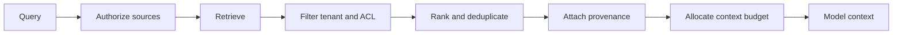

# Memory and context

[← Reference architecture](reference-architecture.md) · [Notes map](../../README.md#notes-map) · Next: [Multi-agent coordination →](multi-agent-coordination.md)

Context is the bounded input assembled for one decision. Memory is state retained for later decisions. Mixing them creates stale facts, privacy leaks, and invisible authority.

## Memory layers

| Layer | Lifetime | Suitable content | Main control |
| --- | --- | --- | --- |
| Turn context | one inference | current request, selected evidence | token and provenance limits |
| Session state | one workflow | plan, completed steps, tool handles | workflow isolation |
| User memory | across sessions | explicit preferences, stable facts | consent, edit, delete, expiry |
| Operational state | system-defined | job status, idempotency records | transactional storage |
| Audit log | retention policy | actors, decisions, effects | append-only access control |

Never store credentials, authentication tokens, hidden policy text, raw sensitive documents, or inferred sensitive traits in model-facing memory.

## Retrieval pipeline



Authorization must occur before and after retrieval: before, to limit eligible sources; after, to account for item-level permissions that changed or were indexed incorrectly.

## Memory write contract

A durable write should include:

```yaml
subject: user:123
fact: "Prefers concise release summaries"
source: explicit_user_statement
observed_at: 2026-07-27T10:00:00Z
expires_at: 2027-01-27T10:00:00Z
confidence: 1.0
sensitivity: low
policy_version: memory-v3
```

Require explicit consent for personal memory, expose view/edit/delete controls, and make expiry the default. Do not silently promote model inference into fact.

## Compaction

Summaries are lossy. Preserve immutable identifiers, constraints, approvals, unresolved risks, and exact side-effect outcomes outside the summary. Mark generated summaries as derived data and retain links to their sources. Recompute when source permissions change.

## Context integrity checklist

- Every retrieved item carries source, timestamp, and trust label.
- Instructions from retrieved content are quoted or delimited as data.
- Tenant and ACL filters are enforced outside the model.
- Context size has per-source and total limits.
- Secrets and sensitive fields are redacted before model access.
- Stale or conflicting facts are visible rather than silently merged.
- Memory deletion removes primary records, indexes, and caches within a documented window.
