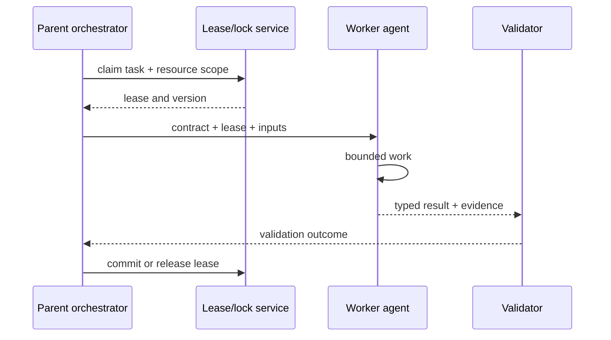

# Multi-agent coordination

[← Memory and context](memory-and-context.md) · [Notes map](../../README.md#notes-map) · Next: [Cost and latency →](cost-and-latency.md)

Multiple agents add concurrency and specialization, but also introduce duplicated work, authority confusion, race conditions, and harder incident reconstruction. Use delegation when tasks are independently verifiable—not as a default architecture.

## Delegation contract

Every delegated task should carry:

- objective and explicit non-goals;
- owned resources and allowed tools;
- read/write boundaries;
- input versions or immutable references;
- deadline, step, token, and cost budgets;
- expected result schema and evidence;
- escalation and cancellation rules.

The parent remains accountable for authorization and final integration. A child cannot expand its own scope or transfer credentials unless policy explicitly allows it.

## Coordination patterns

| Pattern | Use when | Guardrail |
| --- | --- | --- |
| Supervisor/worker | tasks need centralized policy | supervisor validates every result |
| Map/reduce | independent items share a schema | deterministic aggregation |
| Debate/review | uncertainty benefits from independent critique | fixed rounds and adjudication rubric |
| Pipeline | stages have stable interfaces | versioned schemas and replayable inputs |

Avoid free-form peer-to-peer swarms when actions can mutate shared state.

## Conflict control

- Prefer single-writer ownership per resource.
- Use leases, optimistic version checks, or transactions for shared state.
- Attach idempotency keys to delegated side effects.
- Do not treat “agent says complete” as a commit acknowledgement.
- Cancel obsolete children and reject results from expired leases.
- Merge code or documents through explicit diffs with validation.

## Failure semantics

Model child outcomes as `succeeded`, `failed_retryable`, `failed_terminal`, `cancelled`, or `unknown`. An unknown outcome after a timeout is not safe to retry until the external effect is reconciled. Preserve parent/child trace links and policy versions.

## When one agent is better

Stay single-agent when tasks are sequential, share a tight context, are cheaper than coordination overhead, or cannot be independently validated. Complexity should buy measurable latency, quality, or isolation improvements.
