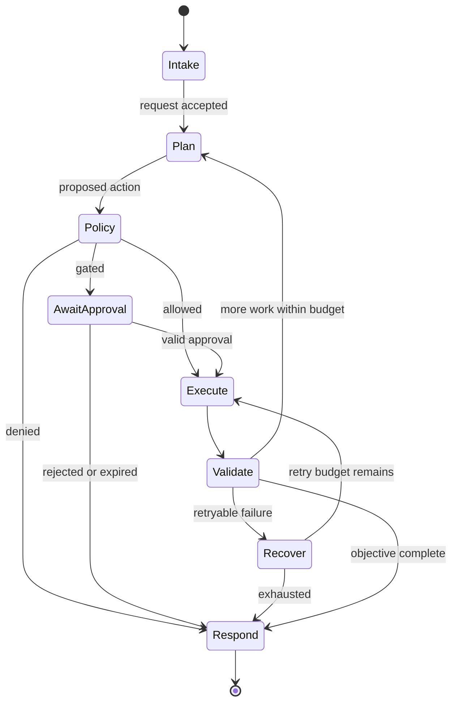

# Reference architecture

[← Notes map](../../README.md#notes-map) · Next: [Memory and context →](memory-and-context.md)

An agent is a control loop around a probabilistic planner. Treat the model as an untrusted decision-support component: useful for proposing actions, never sufficient for authorizing them.

## Components and responsibilities

| Component | Owns | Must not delegate to the model |
| --- | --- | --- |
| Ingress gateway | identity, tenant, rate limits, request classification | authentication |
| Context builder | retrieval, provenance, redaction, token allocation | data access policy |
| Orchestrator | state machine, deadlines, step budget, cancellation | termination guarantees |
| Policy engine | tool eligibility, argument constraints, approval rules | authorization |
| Tool adapter | schema validation, credentials, idempotency, result normalization | secret handling |
| Result validator | type, bounds, provenance, success semantics | acceptance of malformed output |
| Observability plane | correlated events, metrics, audit retention | audit truth |

## Control loop

Persist the state transition before a side effect when recovery could otherwise repeat it. Apply a maximum step count, wall-clock deadline, cumulative cost budget, and cancellation signal at every loop.

## Trust boundaries

- **User boundary:** identity and intent are not the same. An authenticated user may still lack permission.
- **Content boundary:** web pages, files, emails, tool output, and memory can contain hostile instructions.
- **Tool boundary:** generated arguments become real-world effects; validate and authorize them independently.
- **Tenant boundary:** retrieval, caches, traces, memory, and credentials must preserve tenant isolation.
- **Operator boundary:** privileged debugging must be audited and should not expose raw secrets or unrelated user data.

## State model

Keep four categories distinct:

1. **Request state:** immutable identity, tenant, original objective, policy version.
2. **Working state:** plan, bounded scratch data, tool results, remaining budgets.
3. **Durable memory:** deliberately written facts with provenance, owner, and expiry.
4. **Audit state:** append-only policy decisions and side-effect outcomes.

Do not use a conversation transcript as the authoritative transaction log. Transcripts are mutable, verbose, and may contain attacker-controlled text.

## Failure posture

Define “fail closed” per operation. A read-only search may degrade to fewer results; a payment, permission change, or outbound message should stop when authorization, validation, or audit storage is unavailable. Surface partial completion explicitly—never let a fluent final response imply atomic success.

## Design questions

- What is the maximum autonomous blast radius?
- Which component owns the canonical state transition?
- Can a repeated request cause a second side effect?
- What evidence proves an action was authorized?
- How are partial success, cancellation, and timeout represented?
- Which data crosses trust or tenant boundaries?
