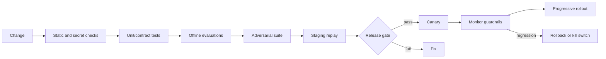

# Deployment

[← Observability](observability.md) · [Notes map](../../README.md#notes-map)

Deploy prompts, policies, tool schemas, models, retrieval logic, and application code as versioned artifacts. Any of them can change behavior.

## Environments

Keep development, staging, and production credentials, data, memory, indexes, callbacks, and audit sinks separate. Synthetic or explicitly approved datasets belong in staging. Do not “test” production writes by relying on the model to avoid dangerous arguments.

## Release pipeline

Compare candidate and baseline on the same versioned dataset. Gate on task quality, unsafe-action rate, latency, cost, and policy compliance—not a single aggregate score.

## Runtime isolation

- Run tool adapters with separate identities and minimum network/filesystem access.
- Keep secrets in a managed secret store and issue short-lived credentials.
- Enforce egress allowlists and resource quotas outside the model.
- Pin dependencies and base images; produce an SBOM and scan artifacts.
- Separate untrusted parsers or code execution into hardened sandboxes.
- Apply concurrency, queue, step, token, time, and spend limits.

## Rollout units

Version and independently roll back:

- application/orchestrator;
- model and decoding configuration;
- system/prompt templates;
- policy bundles;
- tool schemas/adapters;
- retrieval index and embedding model;
- evaluation dataset and graders.

Record the exact tuple on every workflow trace.

## Safe rollout

Begin with shadow or read-only traffic, then internal users, a small canary, and progressive cohorts. For write-capable agents, initially require approval for every effect and loosen only with evidence. Avoid experiments where variants have different unreviewed permissions.

## Rollback and kill switches

Provide immediate controls to disable a tool, force read-only mode, stop new workflows, revoke capabilities, and pin a prior model/policy version. Rollback may not undo completed effects; pair it with reconciliation and compensation runbooks.

## Production readiness

- [ ] Owners and on-call path are documented.
- [ ] SLOs and safety guardrails have alerts.
- [ ] Evaluation and adversarial suites pass against the release tuple.
- [ ] Tool contracts cover timeout, idempotency, and unknown outcomes.
- [ ] Tenant isolation and deletion paths are tested.
- [ ] Audit storage remains available under dependency failure.
- [ ] Rollback, kill switch, reconciliation, and incident drills have been exercised.
