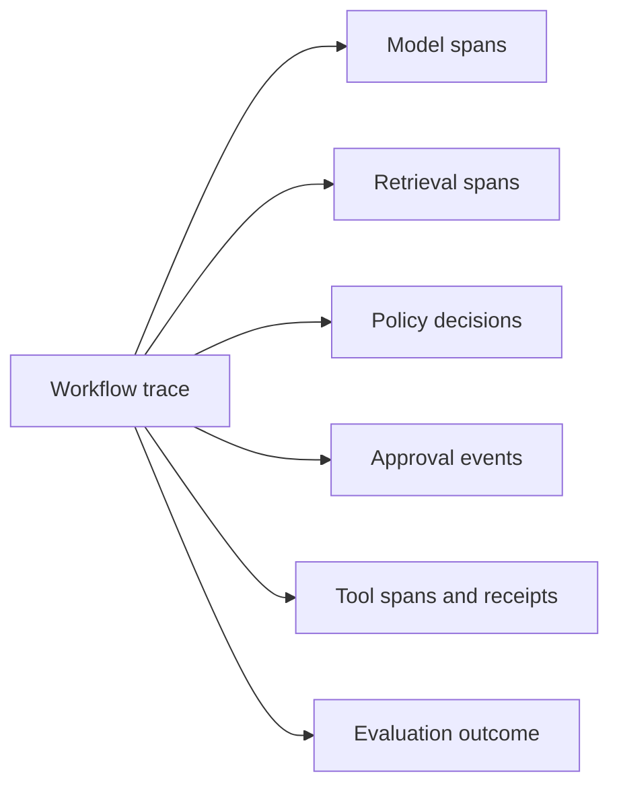

# Observability

[← Reliability](reliability.md) · [Notes map](../../README.md#notes-map) · Next: [Deployment →](deployment.md)

Agent observability must explain decisions and effects without turning private context into a second data leak.

## Correlation model

Use a workflow ID across ingress, model calls, retrieval, policy, approvals, tools, and final response. Each child agent or tool call gets a span ID and links to its parent. Record immutable resource identifiers rather than display names alone.

## Signals

### Metrics

- task success and partial-completion rate;
- tool success, denial, ambiguous outcome, and retry rate;
- end-to-end and per-stage p50/p95/p99 latency;
- tokens and cost per successful task;
- approval request, rejection, edit, and expiry rates;
- policy denials and injection/DLP detections;
- loop depth, fan-out, cancellation, and budget exhaustion.

### Trace attributes

Record model/provider/version, prompt-template version, policy version, tool/schema version, retrieval source IDs, token counts, cache status, deadlines, and outcome codes. Avoid raw prompts and tool payloads by default.

### Audit events

For each side effect capture initiating principal, tenant, delegated actor, canonical action hash, policy decision, approval reference, tool receipt, timestamp, and outcome. Send audit records to access-separated, append-oriented storage.

## Privacy

Classify telemetry fields, allowlist what may be recorded, redact before export, encrypt in transit/at rest, and set retention by purpose. Hashing low-entropy personal data is often reversible; prefer opaque internal IDs. Restrict prompt capture to short-lived, sampled, access-controlled debugging with explicit justification.

## Alerts and SLOs

Define an SLO around user outcomes, such as “99% of eligible read-only tasks complete correctly within 10 seconds.” Pair it with guardrails for unsafe-effect rate and audit completeness. Alert on symptoms: tail latency, unknown outcomes, cross-tenant canary access, retry storms, approval-preview mismatches, and cost per success.

## Incident reconstruction

An investigator should answer:

1. Who initiated the workflow and under which tenant?
2. What data and memory entered context, with provenance?
3. What did the model propose?
4. Which policy and human decisions authorized each effect?
5. What exactly did the external system confirm?
6. What did the user see?

If those questions require raw chain-of-thought, the observability design is incomplete. Record concise decision summaries and structured evidence instead.
