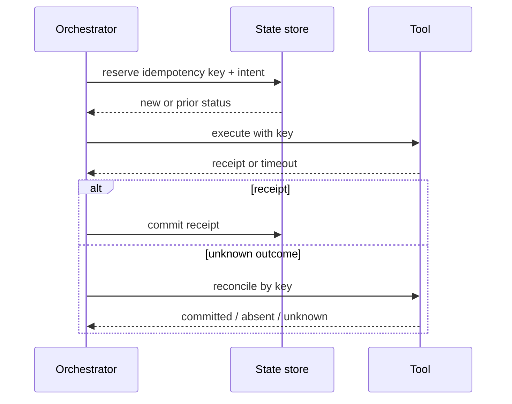

# Reliability: retries and idempotency

[← Notes map](../../README.md#notes-map) · Next: [Observability →](observability.md)

Agent workflows combine non-deterministic planning with fallible networks and stateful tools. Reliability requires explicit semantics for each step; “try again” is not a strategy.

## Failure taxonomy

| Failure | Example | Response |
| --- | --- | --- |
| Invalid | schema or invariant violation | do not retry; repair arguments within step budget |
| Denied | policy or permission failure | do not retry; explain or request valid approval |
| Retryable | throttling, transient unavailable | bounded retry with jitter and deadline |
| Unknown outcome | timeout after request was sent | reconcile before retry |
| Terminal | deleted resource, permanent provider error | stop and report |

Do not let the model classify transport errors from prose. Tool adapters return structured error codes and retry guidance.

## Idempotency

Generate a stable key from workflow, logical operation, target, and intent version. Persist the key and intended effect before execution. The receiving service should atomically store the result against that key.

An idempotency key does not make different arguments equivalent. Reject reuse with a mismatched canonical request hash.

## Retry policy

- Retry only operations declared safe or idempotent.
- Use exponential backoff with jitter and server hints.
- Bound attempts by both count and end-to-end deadline.
- Apply retry budgets to prevent outage amplification.
- Never regenerate side-effect arguments during a transport retry.
- Use circuit breakers for persistent dependency failure.

## Compensation

For multi-step effects without transactions, define a saga: completed steps, compensating action, and owner for manual recovery. Compensation is a business operation, not rollback; it can fail and must be audited.

## Recovery state

Persist workflow state at deterministic checkpoints. On restart, reconcile in-flight effects before continuing. Mark the user-visible result as `complete`, `partial`, `failed`, or `pending_reconciliation`, with per-action receipts.

## Tests

Inject failure before send, after send/before receipt, after receipt/before persistence, during retry, and during compensation. Verify that duplicate effects do not occur and that an operator can resolve every unknown outcome.
