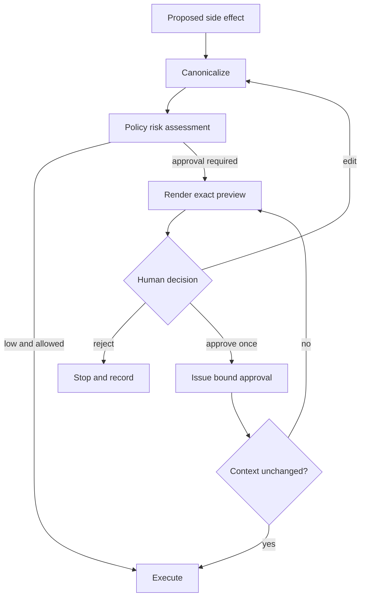

# Human approval

[← Tool permissions](tool-permissions.md) · [Notes map](../../README.md#notes-map) · Next: [Prompt-injection defense →](prompt-injection-defense.md)

Approval is a risk control, not a modal dialog. It works only when the reviewer understands the exact effect and the approved artifact cannot change afterward.

## Require approval when

- the action is irreversible or costly to reverse;
- it communicates externally in the user’s name;
- it changes access, identity, money, production, or legal records;
- scope exceeds a user- or organization-defined threshold;
- policy confidence is insufficient or inputs conflict;
- an approval is required by regulation or separation-of-duties policy.

Routine low-risk actions should be constrained and audited rather than creating approval fatigue.

## Approval object

Bind approval to a canonical action digest:

```json
{
  "actor": "user:123",
  "action": "repository.change_visibility",
  "resource": "repo:acme/payments",
  "arguments_hash": "sha256:...",
  "display_summary_hash": "sha256:...",
  "policy_version": "2026-07-01",
  "expires_at": "2026-07-27T11:00:00Z",
  "nonce": "single-use-value"
}
```

If recipient, content, resource, policy, or material context changes, invalidate approval. Prevent replay with a single-use nonce and record both the approver and initiating principal.

## Review experience

Show the action, target, diff or payload, expected impact, reversibility, source evidence, and reason it was proposed. Highlight hidden or normalized differences such as Unicode domains, expanded groups, redirects, or bulk scopes. Offer **approve once**, **reject**, and **edit**; never preselect approval.



## Anti-patterns

- “Allow agent to continue?” without effect details.
- Approval for a plan rather than the final action.
- Broad “always allow” grants hidden in a confirmation flow.
- Treating silence or timeout as consent.
- Letting one approval cover retries with changed arguments.
- Asking the model whether an action is safe.

## Measure the control

Track approval frequency by risk class, rejection and edit rates, time to decision, expired approvals, repeated prompts, post-approval failures, and incidents where the preview did not match the effect. High automatic approval rates may indicate fatigue, not safety.
