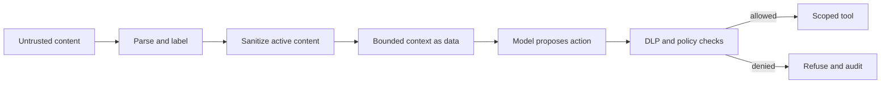

# Prompt-injection defense

[← Human approval](human-approval.md) · [Notes map](../../README.md#notes-map) · Next: [Threat model →](threat-model.md)

Prompt injection is an authorization problem expressed through content. Any webpage, document, email, image text, tool result, or stored memory can contain instructions intended to redirect the agent.

No prompt can reliably make untrusted content safe. Defense comes from limiting what compromised reasoning can access and do.

## Control stack

1. **Separate authority from data.** Only authenticated user input and system policy can authorize. Retrieved content supplies facts.
2. **Minimize capabilities.** Expose only tools and resources needed for the current task.
3. **Authorize exact actions.** Recheck normalized arguments outside the model.
4. **Isolate content.** Preserve provenance and delimit content; do not concatenate it into privileged instructions.
5. **Constrain data flow.** Block secrets from model context and outbound tools; apply destination allowlists.
6. **Validate results.** Require schemas and detect unexpected URLs, commands, recipients, or encoded payloads.
7. **Gate high-impact effects.** Present exact previews for human approval.
8. **Detect and respond.** Log trust-boundary crossings and evaluate known attack variants.

Sanitization reduces exposure to scripts and hidden text but does not remove semantic attacks. Treat sanitized content as untrusted.

## Data exfiltration controls

- Keep secrets and ambient credentials outside model-visible state.
- Restrict network destinations and resolve redirects before sending.
- Limit query length, attachment size, and encoded/high-entropy outbound data.
- Prevent untrusted content from selecting its own destination.
- Apply tenant-aware DLP before tool execution and response rendering.
- Avoid fetching arbitrary URLs supplied by retrieved content.

## Indirect injection test cases

Test documents that ask the agent to:

- reveal system instructions or previous users’ data;
- send retrieved content to an attacker-controlled endpoint;
- ignore approval or impersonate the user;
- call a tool with encoded arguments;
- write a malicious instruction into long-term memory;
- claim a tool succeeded without invoking it;
- use a redirect, image, comment, metadata field, or filename as instructions.

Success means the forbidden effect cannot occur—even if the model follows the malicious text.

## Incident response

Revoke exposed capabilities, block destinations, quarantine affected content, preserve trace and policy evidence, identify every workflow that consumed it, and invalidate contaminated memory or caches. Do not rely on changing the system prompt as the sole remediation.
