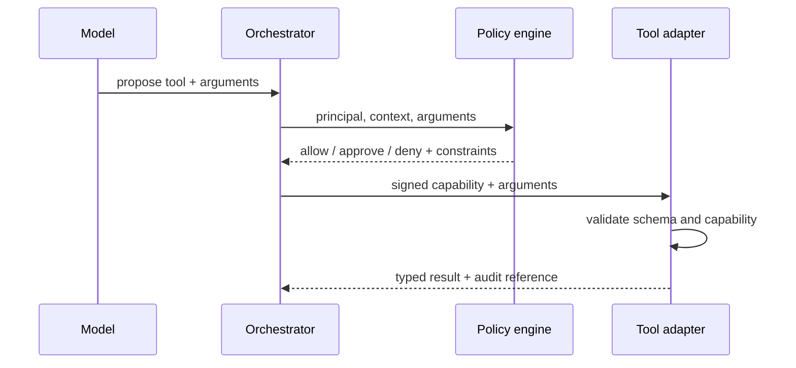

# Tool permissions

[← Notes map](../../README.md#notes-map) · Next: [Human approval →](human-approval.md)

Tools turn generated text into authority. Permission checks therefore belong in deterministic infrastructure at the moment of execution—not in a system prompt and not only when the tool list is assembled.

## Capability model

A capability should bind:

```yaml
principal: user:123
tenant: acme
tool: email.send
actions: [create]
constraints:
  recipient_domains: [example.com]
  max_recipients: 5
  attachments: false
purpose: support_follow_up
expires_at: 2026-07-27T11:00:00Z
approval_id: apr_01J...
```

Capabilities should be least-privilege, short-lived, non-transferable, and audience-bound to one tool adapter. Credentials stay in the adapter; the model receives opaque handles.

## Authorization flow



The adapter rechecks the capability to prevent a compromised orchestrator or time-of-check/time-of-use argument change.

## Risk classification

| Class | Example | Default |
| --- | --- | --- |
| R0 | public, bounded read | allow with rate limits |
| R1 | private read | allow when ACL and purpose pass |
| R2 | reversible write | preview or approval based on scope |
| R3 | outbound communication, permission change | explicit approval |
| R4 | irreversible/high-impact action | strong confirmation, separation of duties, or prohibit |

Classification considers actual arguments. Reading one permitted issue differs from exporting an entire repository; drafting an email differs from sending it.

## Tool contract

Each tool declares:

- strict input and output schemas;
- side effects and reversibility;
- required capability and risk class;
- timeout, result-size limit, and retry policy;
- idempotency support;
- sensitive fields and audit redaction;
- error taxonomy (`invalid`, `denied`, `retryable`, `unknown_outcome`, `terminal`).

Reject unknown fields and normalize identifiers before policy evaluation. Never interpolate model output directly into shell, SQL, URLs, or templates.

## Revocation and confused deputies

Check revocation and current resource permissions at execution. Bind requests to the initiating principal, tenant, purpose, and resource. A service’s broad credential must not let an agent perform actions the initiating user could not perform directly.

## Review checklist

- [ ] Policy is enforced outside the model.
- [ ] Exact normalized arguments are authorized.
- [ ] Credentials never enter model context or logs.
- [ ] Bulk access and wildcard resources require separate grants.
- [ ] Tool output is typed, bounded, and treated as untrusted data.
- [ ] Policy decision and version are auditable.
- [ ] Revocation takes effect within a documented interval.
